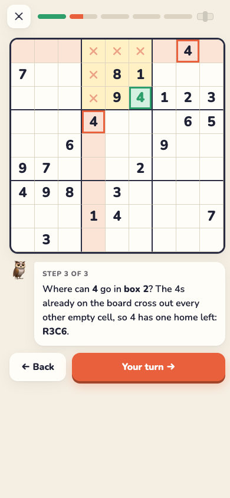
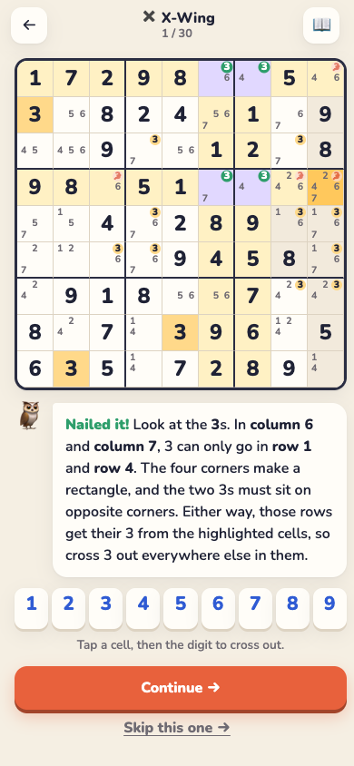
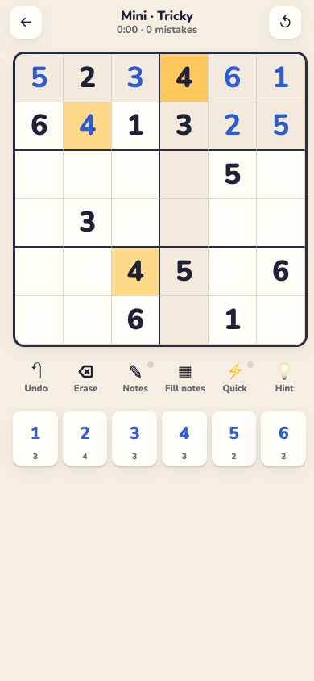

<p align="center">
  
</p>

<h1 align="center">Sudoku Dojo</h1>

<p align="center">
  <strong>Learn Sudoku techniques step by step: from Hidden Singles to Swordfish.</strong><br>
  Real puzzles, a coach that shows you <em>why</em>, and belts to earn.
</p>

<p align="center">
  <a href="https://sudoku-dojo-eight.vercel.app"><strong>▶ Play it now</strong></a> ·
  <a href="https://sudoku-dojo-eight.vercel.app/app/">Open the app</a> ·
  <a href="#run-it-locally">Run locally</a>
</p>

<p align="center">
  
  
  
</p>

---

## Why

Most Sudoku apps give you puzzles and a "reveal cell" button. That makes you faster at guessing, not better at seeing.

Sudoku Dojo teaches the **techniques** strong players use, one at a time. You learn each one on real positions, picked so that technique is the move that unlocks the puzzle.

## What's inside

| | |
|---|---|
| 🥋 **12 lessons, 5 belts** | Each lesson has a short idea, an everyday comparison, and a 3-step walkthrough on a real board. Then you solve 3 on your own. Nothing is locked. |
| 💡 **Hints that teach** | Level 1 names the technique. Level 2 lights up where to look. Level 3 explains the move and can apply it. Hints also catch mistakes, including notes that rubbed out the right answer. |
| 🎯 **Practice any technique** | 30 real positions for every technique, so you can drill X-Wings until they're automatic. |
| ⚡ **Technique Rush** | 90 seconds to spot as many techniques as you can. Each find adds 3 seconds; a wrong tap costs 2. |
| 🧩 **Play** | 9×9 in five levels (Gentle → Expert), a daily puzzle, and **Mini 6×6** for quick games. |
| 🔒 **Quick fill** | Pick a digit once, then tap cell after cell. A big speed boost on phones. |
| 🔦 **Smart highlights** | Tap a number and every copy lights up. Tap a cell and its row, column and box glow. |
| 🎉 **Delight** | Pops, chimes, haptics, a ripple across finished rows and boxes, and confetti. |
| 📈 **Progress** | Streaks, XP, belts, best time per level and recent games, all stored on your device. |
| ✈️ **Installable and offline** | It's a web app you can install (PWA). Add it to your home screen and it works without internet. |

## The techniques

| Belt | Technique | The idea in one line |
|---|---|---|
| ⬜ White | Full House | Eight digits in a row, column or box, so the ninth is the missing one. |
| ⬜ White | Hidden Single · Box | Copies of a digit cross out every cell of a box but one. |
| ⬜ White | Hidden Single · Line | The same idea in a row or column. |
| ⬜ White | Naked Single | A cell sees eight different digits, so one is left. |
| 🟨 Yellow | Pointing Pair | A digit's notes in a box all sit on one line, so clear the rest of that line. |
| 🟨 Yellow | Box-Line Reduction | A digit's notes in a line all sit in one box, so clear the rest of that box. |
| 🟩 Green | Naked Pair | Two cells share the same two notes, so they own those digits. |
| 🟩 Green | Hidden Pair | Two digits fit in only the same two cells, so clear the cells' other notes. |
| 🟩 Green | Naked Triple | Three cells use only three digits between them. |
| 🟫 Brown | X-Wing | One digit makes a rectangle across two rows (or columns). |
| 🟫 Brown | Y-Wing | A pivot and two pincers: whichever way it goes, one pincer gets digit Z. |
| ⬛ Black | Swordfish | An X-Wing across three rows (or columns). |

## How a hint decides what to show

When you press **Hint**, the app runs the same checks a teacher would, in this order:

```
1. Is any digit you placed wrong?              → point at it
2. Do your notes rule out a correct digit?     → point at that cell
3. Is there a Full House?                      → teach it
4. …a Hidden Single in a box? …in a line?      → teach it
5. …a Naked Single?                            → teach it
6. …Pointing Pair → Box-Line → Naked Pair →
   Hidden Pair → Naked Triple → X-Wing →
   Y-Wing → Swordfish                          → teach the first one found
```

It always picks the **simplest** move available, the same one a human should look for first.

## Every puzzle is checked

The puzzles aren't hand-typed. A build script generates about 10,000 puzzles and keeps only the ones that pass every check:

- Each puzzle has **exactly one solution** (checked by a brute-force solver).
- Each puzzle can be solved **by logic alone** using the 12 techniques, so a hint is always available.
- Every logical step is compared with the real solution. One wrong placement or elimination fails the whole build.
- Each lesson position is checked so its technique is truly the **easiest** move there.

6×6 puzzles are made on the fly in your browser, with the same uniqueness and logic checks.

## Run it locally

No build step and no dependencies. Any static file server works:

```bash
git clone https://github.com/bnishit/sudoku-dojo.git
```

```bash
cd sudoku-dojo && python3 -m http.server 5178
```

Then open <http://localhost:5178> for the landing page or <http://localhost:5178/app/> for the app.

To regenerate the puzzle and lesson bank (Node 18+):

```bash
npm run bank
```

## Project structure

```
.
├── index.html             Landing page
├── app/                   The app (installable, works offline)
│   ├── index.html
│   ├── css/styles.css     Design tokens, light and dark theme, animations
│   ├── js/engine.js       Board geometry (9×9 and 6×6), solver, generator, 12 technique finders
│   ├── js/board.js        Draws the board, notes and technique highlights
│   ├── js/lessons.js      Lesson text, belts and difficulty levels
│   ├── js/app.js          Screens, game logic, hints, progress storage
│   ├── js/fx.js           Sound, haptics and confetti
│   ├── data/bank.js       Generated puzzles and lesson positions
│   ├── sw.js              Offline cache
│   └── manifest.webmanifest
├── tools/build-bank.js    Generates and checks data/bank.js
├── assets/                Screenshots
└── vercel.json            Static hosting config
```

## Tech

- Plain HTML, CSS and JavaScript modules. No framework and no build.
- Board state uses bitmasks: each cell's notes are one number, with bit *d* meaning "digit *d* is still possible."
- Every technique finder returns a structured step: what to place or remove, which cells and notes to highlight at each hint level, and a plain-English explanation. Lessons, hints and Rush all use that one step format.
- Progress is stored in `localStorage` and never leaves the device.
- The service worker fetches from the network first, so you always get the latest version when online and the cached one when offline.

## Keyboard shortcuts

| Key | Action |
|---|---|
| `1`–`9` | Place a digit |
| `Shift` + digit | Toggle a note |
| Arrow keys | Move the selection |
| `N` | Notes mode |
| `Q` | Quick fill |
| `Z` | Undo |
| `H` | Hint |
| `Backspace` | Erase |

## License

MIT. See [LICENSE](LICENSE).
